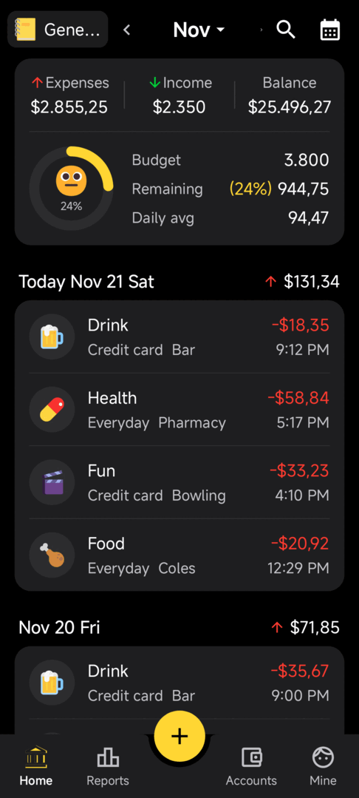
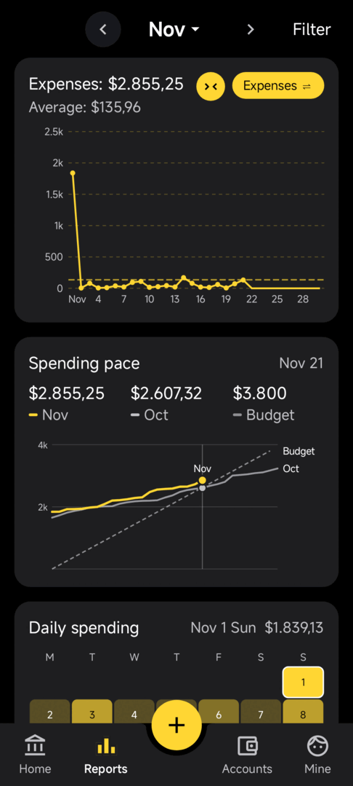
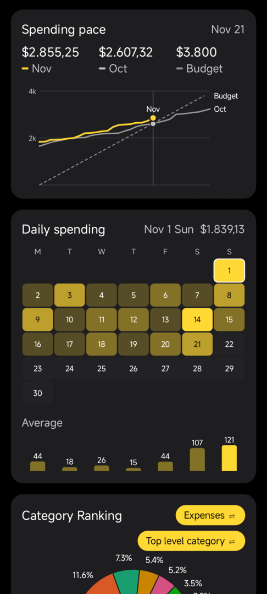
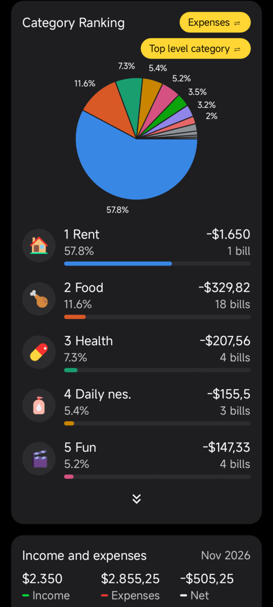
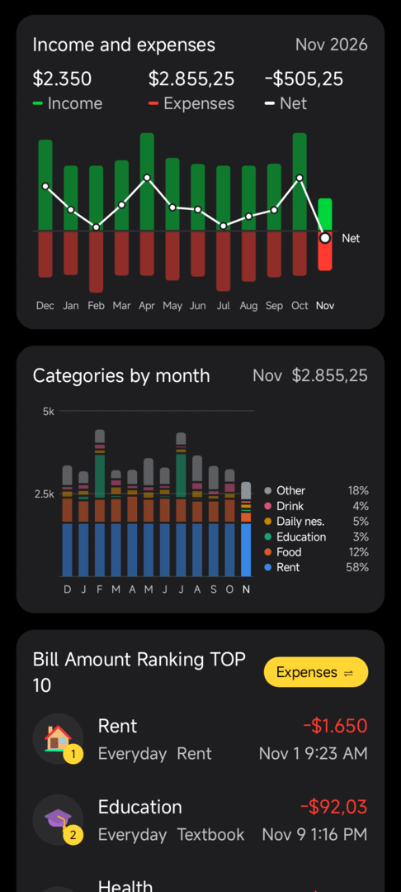
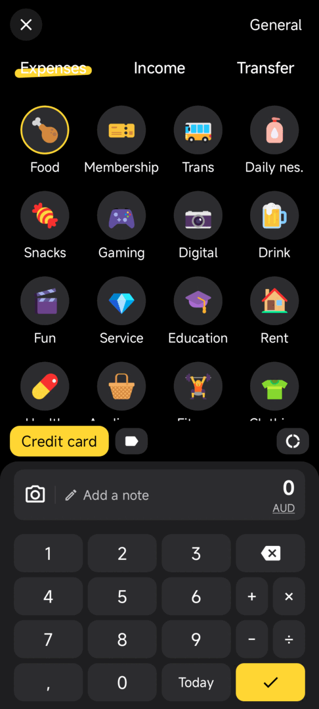
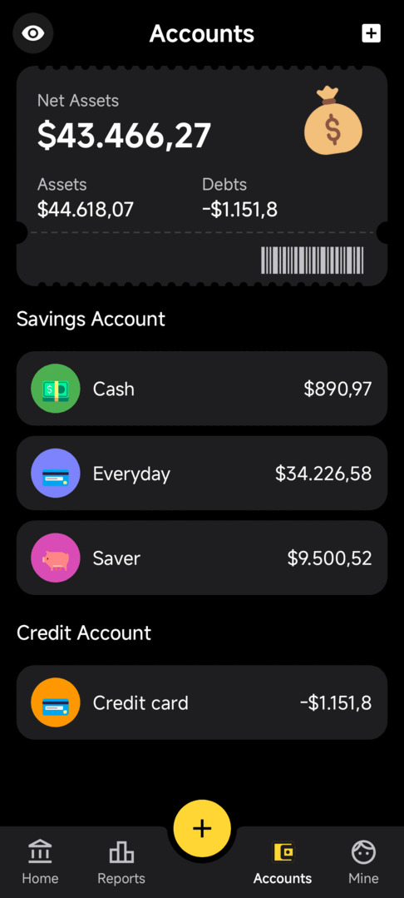
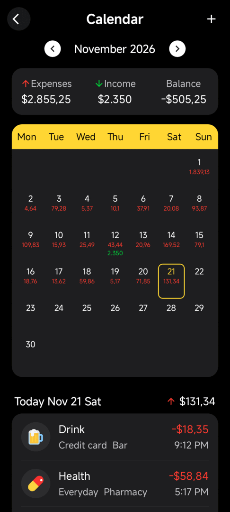
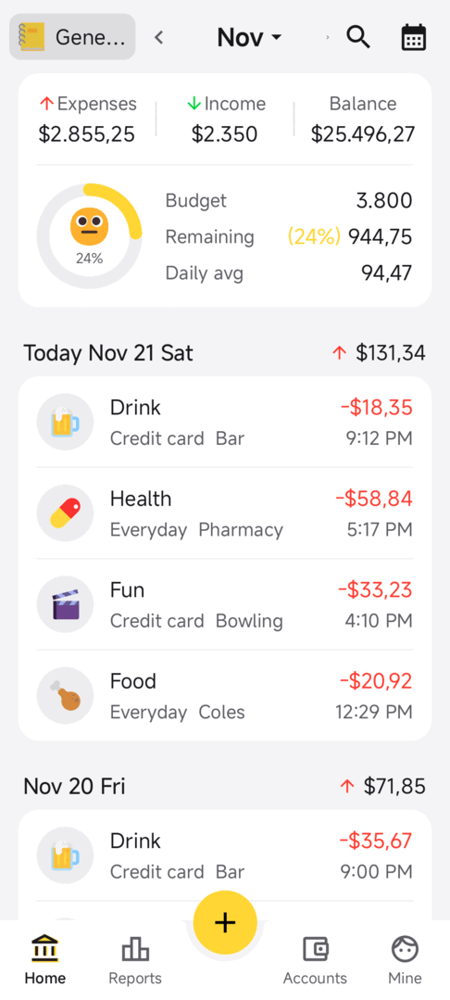

<p align="center">
  
</p>

<h1 align="center">xrnwal</h1>

A local-first personal money tracker for Android: ledgers, accounts, categories, budgets, recurring
bills, savings plans, reports, reminders, CSV and backup files, and sync to a server of your own.
Your data lives on the phone. Only two things use the network: the sync, if you connect a server, and
the exchange-rate refresh, which sends the base currency code and runs only when you press the
refresh button.

Kotlin and Jetpack Compose, with Room for storage. Minimum Android 8.0. Version 0.5.3 (build 12).
Laid out and working like the money app it replaced, in its own code and with its own artwork; see
[where it differs](#where-it-differs-from-money-manager). It was called xrnwallet
(`com.xern.xrnwallet`) until 0.6.0; see [moving from xrnwallet](#moving-from-xrnwallet).

## Screenshots

Drawn without a phone from the made-up wallet in `ui/Previews.kt` (fourteen months of a student
with a job), with `android preview render`, at phone size.

| Home | Reports | Reports, further down |
| --- | --- | --- |
|  |  |  |
| The month's figures, the budget ring, and the bills by day. | The trend against its average, fitted to the card. | Spending pace against last month and the budget, and the month day by day. |

| Categories | Twelve months | Add a bill |
| --- | --- | --- |
|  |  |  |
| Categories ranked, each row opening its bills. | Twelve months of income against expenses, and of the largest categories. | Categories, the account, and a keypad that adds up sums. |

| Accounts | Calendar | Light |
| --- | --- | --- |
|  |  |  |
| Net assets, then each account by type. | Each day's expenses and income, and the chosen day's bills. | Home in the light theme. |

## What it does

- **Bills:** expenses, income and transfers between accounts, with fees, tags, notes, photos and
  future dates. The keypad adds up sums as you type. Tap a bill to change it, or hold it to edit it,
  add it again today or delete it; Undo brings a deleted bill back for a few seconds. A new bill
  starts on the account the last one was recorded on.
- **Home and Calendar:** expenses, income and balance for one ledger or all of them, by week, month,
  year or a range of your own, with search, a budget card and checklists. Calendar shows each day's
  totals.
- **Reports:** by week, month, year or range, with a filter by tag, ledger and account. A trend line
  against its average, fitted to the card or scrolling, read by touch; spending pace against the
  period before and the budget; daily spending as a shaded calendar with the average per weekday;
  twelve months of income, expenses and net, and of the five largest categories; categories
  ranked as a pie and rows, each row opening its bills; and the ten largest bills.
- **Accounts:** each balance in its own currency, converted for net assets, and amounts hidden when
  you'd rather not show them. Balance Correction (or editing Current balance) records the real
  balance as a correction in the account's history, and the balance counts from it; deleting it
  undoes it. An account named after a known bank or wallet shows that brand's logo.
- **Welcome:** a fresh install opens on three first steps (add an account, a first bill, a budget),
  each ticked once done, plus importing from another app or restoring a backup.
- **Planning:** a monthly budget and budgets per category, recurring bills that record themselves
  (and ask what to do about dates already past), and savings plans that are fixed, growing or open.
- **Currencies:** a base currency, others with their rates, and a converter. A bill keeps the rate it
  was recorded at, so history doesn't move when rates change.
- **Made to fit:** ledgers, categories and subcategories, tags, light and dark with colour accents,
  your own start of month, number formats, reminders, six home-screen widgets and eight icon colours.
- **Lock:** a PIN of 4 to 8 digits, a pattern or biometrics. After five wrong tries it waits 30
  seconds, twice as long after each further miss. While a lock is set, widgets show dots instead of
  amounts and Recents keeps no picture of the app.
- **Files:** CSV export and import, in its own format or a general template, and backup files that
  hold everything but the app lock, photos included.

Every gesture has a button that does the same, and nothing is ever deleted by a swipe.

## Sync

Optional. The phone sends its whole wallet to your server as one document (gzipped when the server
says it takes that; bill photos go up one by one beside it), a few seconds after a change and when
the app opens; it retries by itself when
the server can't be reached, and checks every 6 hours. A change made on another phone comes down the
same way. It uses the shared sync login of the owner's other apps.

Nothing is overwritten without asking. When both sides changed, when a new phone meets a server that
already has a copy, when this phone was restored from a file or had all its data deleted, or when the
server went backwards, the app asks which copy to keep, and files the other on the server first. The
server keeps every copy it replaces, the last 20 and the first of each day for 60 days, so Earlier
copies can undo a choice. [docs/feature-spec.md](docs/feature-spec.md#sync) has the full table of
cases.

The app lock never leaves the phone: taking the server's copy, or restoring a backup file, keeps this
phone's own lock. The login is stored encrypted with a key in the phone's keystore, and the release
build only accepts `https://` addresses.

## Build and test

```sh
./gradlew :app:testDebugUnitTest      # 164 unit tests
ANDROID_USER_HOME=$HOME/.android ./gradlew :app:assembleRelease   # app/build/outputs/apk/release/app-release.apk
adb install -r app/build/outputs/apk/release/app-release.apk
ANDROID_USER_HOME=$HOME/.android ./gradlew :app:assembleDebug     # app/build/outputs/apk/debug/app-debug.apk
android preview render "?:app" --fqn=com.xern.xrnwal.ui.PreviewsKt.ReportsMonthPreview
```

The unit tests cover adding bills and sums, dates, the domain rules (balances, corrections,
budgets, recurring rules, currencies), Reports' figures, CSV, backup files, the sync engine and the
phone's side of the server, the app lock, reminders and the look's colours. CI
(`.github/workflows/ci.yml`) runs them with a debug build and lint, and the server tests on Python
3.14, on every push to `main` and every pull request.

The debug build's `ui/Previews.kt` draws Reports (every period and both chart looks), the add page,
Welcome, twelve months, the category icons and the app tiles from made-up bills, with no phone,
through Google's `android` command.

Use the release build day to day. A debug build responds about three times slower, because Android
can't precompile it. Both are signed with the build machine's debug key, so either installs over the
other and keeps the app's data. That key isn't in the repo and must never be added to it. Build with
`ANDROID_USER_HOME=$HOME/.android`: without it, AGP 9 makes and uses a different debug key in
`~/.config/.android/`, and installing over the phone's copy fails as an incompatible update.

## Sync server

`server/xrnwal-sync.py` keeps a copy of the wallet on a home server. It is one Python file, needing
only `bcrypt` beyond the standard library. Use Python 3.14.7 or newer: older versions answer a malformed request with no HTTP status line, which the server tests check for.

```sh
python3 -m unittest server/test_xrnwal_sync.py   # server tests
python3 -m unittest server/test_deploy.py        # deploy.sh against a made-up phone
server/deploy.sh [ssh-host]                      # install, update or move it over (Termux, runit, Funnel)
```

In the app: Mine, Data synchronization, then the server's address ending in `/xrnwal`.

It keeps one JSON document per user (the backup format, without the app lock) and the bill photos,
behind HTTP Basic auth checked against the htpasswd users file shared with the other xrn sync
servers. Every write needs `If-Match`, so a phone that never synced can't wipe the copy by
accident; `/versions` lists the earlier copies, and `/health` answers without a login. Wrong
passwords lock an address out for a while. Behind a proxy that passes the path on, it answers under
`/xrnwal` and under `/xrnwallet`, the path from before the rename.

`deploy.sh` runs the server tests first and changes nothing if they fail. It runs the server as the
runit service `xrnwal-sync` on port 5237 from `~/xrnwal-sync` (data in `~/xrnwal-sync/data`, log in
`$PREFIX/var/log/sv/xrnwal-sync`) and publishes it under `/xrnwal` with Tailscale Funnel. Its run
script first calls `~/.local/bin/sv-guard`, the home server's guard that stops a copy of the program
left running after its supervisor died, so the deploy refuses to start without it. It ends by saying
what it did.

## Moving from xrnwallet

The app was xrnwallet, `com.xern.xrnwallet`, until 0.6.0. The new id installs xrnwal as a new app,
empty, beside the old one.

- **The server:** the next `server/deploy.sh` moves it over. On a server with `~/xrnwallet-sync` and
  no `~/xrnwal-sync`, it stops the `xrnwallet-sync` service and removes it, stops any copy of the old
  program still holding the port, renames the folder with its data in one move, moves the log, and
  starts `xrnwal-sync` on the same port. `/xrnwallet` stays published beside `/xrnwal`, pointing at
  the same port, so the old app keeps syncing until you take it off with
  `tailscale funnel --https=443 --set-path=/xrnwallet off`; later deploys don't put it back. With both
  folders there it changes nothing and says so. Run again, it moves nothing more.
- **The phone:** in xrnwal, Mine, Data synchronization, connect with the address ending in `/xrnwal`
  and the same login. The server already has a copy, so it asks: **Use the server's copy** brings the
  wallet and its photos down, after filing the new app's starting ledger on the server under
  Earlier copies. A saved address ending in `/xrnwallet` is moved to `/xrnwal` when the app opens.
- **Backup files** from xrnwallet restore as they are (Data synchronization, Restore from a file): the
  format names no app, and photos are found by file name.
- **Set again on the phone:** the app lock, the widgets, the icon colour, and HyperOS Autostart, which
  reminders need to come back after a restart. They belong to the installed app, not the wallet.

## Limits

- One phone at a time in practice: two phones editing at once get asked which copy to keep, they
  don't merge.
- English only; no camera on bills (the photo picker instead); no voice entry.
- Biometric unlock and Recents on HyperOS haven't been tested ([docs/status.md](docs/status.md)).
- The bank and wallet logos in `res/drawable-nodpi/logo_*` (Investment apart) are their owners'
  trademarks, used only to label your own accounts. The app is not affiliated with any of them.

## Where it differs from Money Manager

xrnwal (then xrnwallet) replaced Money Manager (an Android expense tracker) on the owner's phone,
with every bill imported from its CSV export and the totals, balances and net assets matching. It
follows its screens, flows and words, without its mascot, notebook covers, key doodles or icons.

- **Added:** sync to your own server with Earlier copies and Disconnect, asking before anything
  is overwritten; Reports' spending pace, daily calendar and twelve-month charts; the budget switch
  on the add page.
- **Done differently:** a tap on a bill opens its editor (one tap, not two); swipes only turn
  pages and a bill is deleted by holding it; Balance Correction asks for the real balance and keeps
  a correction, where Money Manager only checks its stored balance; averages use calendar days, so a
  month with the daylight-saving change isn't a day short; one font; five accent colours instead of
  whole themes; six widgets of its own design.
- **Missing:** the other 12 languages, the camera, voice entry, Google Drive sync (replaced), and
  Rate, Share, Feedback, More Apps and Restore Purchase.

[docs/status.md](docs/status.md) has the full list, how the comparison was made, and what moving
across from its CSV export involves.

## Credits

- MiSans by Xiaomi, used under the MiSans font licence (free for commercial use when the software
  notes that it uses MiSans; the Mine page does). The font files are not covered by this repository's
  licence. https://hyperos.mi.com/font/en/ (see [docs/licenses/misans.txt](docs/licenses/misans.txt)).
- The colour icons are drawn from Microsoft's [Fluent Emoji](https://github.com/microsoft/fluentui-emoji)
  (MIT licence, see [docs/licenses/fluentui-emoji.txt](docs/licenses/fluentui-emoji.txt));
  `tools/fluent_icons.py` makes them, and makes the ones a new emoji in the code needs.
- The bank and wallet logos are their owners' trademarks, used only to label your own accounts.

## Licence

MIT, see [LICENSE](LICENSE). The MiSans font files and the bank and wallet logos are not covered by it.

## Docs

- [Feature spec](docs/feature-spec.md): what every screen does.
- [Status](docs/status.md): what has been tested, and where the app differs from the spec's reference.
